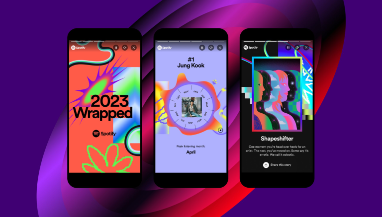

<!-- For the assignment I edited the article to remove some repetition and fixed the flow. I would want to do another round of updates if I were submitting it to the journal. -->

# Streaming the Self: Spotify and the Algorithmic Mirror

What does it mean to know yourself through data? From tracking daily steps and sleep cycles to documenting listening habits, self-tracking offers new ways to understand our behaviours and routines. However, as these practices become increasingly common, questions emerge about whether collecting personal data truly deepens self-understanding or encourages new forms of self-surveillance. 

<!-- Added descriptive elements when hovering links -->

Although Spotify may not resemble a fitness tracker or sleep app, it operates within the same logic of self-tracking by monitoring and organizing user behaviour into data. This reflects the principles of the [Quantified Self](https://en.wikipedia.org/wiki/Quantified_self#:~:text=Quantified%20self%20is%20both%20the%20cultural%20phenomenon,of%20improving%20physical%2C%20mental%2C%20and%20emotional%20performance. "A Wikipedia article explaining the Quantified Self movement and the practice of self-tracking."), which seeks to make the self measurable and visible through data. As [Gary Wolf](https://quantifiedself.com/gary-wolf-bio/ "A background on Gary Wolf from the Quantified Self website.") describes it, this process is rooted in “self-knowledge through numbers.” But what happens when the data we use to understand ourselves is collected and interpreted by a platform with its own commercial interests? 

Spotify offers users opportunities to reflect on their musical taste, moods, and habits, but it also uses this information to personalize recommendations and influence what they listen to next. This post explores how Spotify blurs the line between self-reflection and algorithmic influence, raising questions about autonomy, personalization, and the role of technology in self-expression.

To understand how Spotify functions as a form of self-tracking, it is useful to consider the broader ideas behind the Quantified Self movement. In his discussion of self-tracking, Wolf draws a connection between the collection of personal data and the pursuit of self-improvement, using athletes as an example of how knowledge can help to improve performance and achieve specific goals: 

> “Athletes are among the pioneers: With their increasingly precise and scientific training regimens, serious competitors now commonly load databases not only with their practice results but also with stats on the biological precursors of optimum performance: heart rate, diet, metabolism, and dozens of other factors. Anywhere the goal is explicit—run faster, weigh less—the ability to plot progress is too powerful to ignore.”

*Now you may ask, how exactly does Spotify act as a self-tracking app?* Spotify makes this process visible through features such as Wrapped, “On Repeat” and “Your Top Songs,” which organize listening habits into recognizable patterns. By presenting information about the artists, genres, and songs users return to most often, Spotify gives listeners an opportunity to reflect on their musical preferences. Listening, which might otherwise be an everyday and largely unconscious activity, becomes something that can be measured, organized, and interpreted.

Spotify’s Daylist takes this process a step further. Unlike Wrapped, which looks back at listening habits over a long period, Daylist generates changing playlists based on users’ listening patterns. These playlists shift throughout the day, mirroring how Spotify perceives your evolving moods and energy levels. Daylists are more than just clever recommendations; they’re a reflection of how the platform algorithmically constructs and predicts your emotional rhythms, reinforcing Spotify’s role as both observer and author of your digital identity.

<!-- Created alt text as none of my images had any previously.  -->

<figure style= "text-align: center;">
     </img>
</figure>

<figure style= "text-align: center;">
     </img>
    <figcaption> Two example Daylist titles. </figcaption> 
</figure>

<iframe data-testid="embed-iframe" style="border-radius:12px" src="https://open.spotify.com/embed/playlist/37i9dQZF1FbFUFF8oqAyAw?utm_source=generator&si=c7e97804f5bf42fc" width="100%" height="352" frameBorder="0" allowfullscreen="" allow="autoplay; clipboard-write; encrypted-media; fullscreen; picture-in-picture" loading="lazy"></iframe>

In doing so, it nudges users toward certain patterns, reinforces habits, and constructs what might be called an algorithmic identity. Just as an athlete tweaks their routine based on performance metrics, we can reflect on our listening data to gain insight into our moods, behaviors, and even aspects of our personality. Unlike traditional self-tracking tools that focus on physical metrics, Spotify turns everyday listening into a form of self-tracking that can offer insight into our emotional and cultural selves. By revealing patterns in our tastes and behaviours, Spotify can help us better understand who we are. At the same time, however, its predictive curation influences the very identity it appears to reflect.

<figure style= "text-align: center;">
     </img>
    <figcaption> A look at the 2023 Spotify Wrapped </figcaption> 
</figure>

For many, features like Spotify Wrapped offer more than mere novelty—they craft a personal narrative. Users dive into their “year in music” to reminisce, share, and reimagine facets of their identity, presenting themselves to others through the lens of their listening habits. In doing so, Spotify fosters a form of digital self-expression and self-recognition, transforming listening into a journey of self-discovery. Yet this sense of empowerment is a paradox. While Spotify positions itself as a mirror reflecting who we are, it also functions as a map, steering us toward pre-curated paths designed to maximize engagement and profit. The personal narrative it creates is carefully constructed through data-driven algorithms that shape our preferences even as they appear to reflect them. This influence extends beyond Wrapped and into Spotify’s everyday interface. Autoplay encourages continuous listening, while personalized playlists like Discover Weekly and Daily Mixes dominate the homepage, guiding users toward music selected on the basis of their existing habits. Rather than simply reflecting individual tastes, these design choices can reinforce familiar listening patterns under the guise of personalization, making further exploration less likely.

<figure style= "text-align: center;">
     </img>
    <figcaption> My daily mixes (April 8th, 2025) </figcaption> 
</figure>

## The Soundtrack of Surveillance: How Spotify Commodifies Data and Shapes Identity

While features like Wrapped and personalized playlists give Spotify the appearance of intimacy and self-reflection, they also raise a broader question: what happens to the data behind these personalized experiences? [Shoshana Zuboff’s](https://shoshanazuboff.com/book/shoshana/ "The biography of Shoshana Zuboff on her website") concept of [surveillance capitalism](https://www.ebsco.com/research-starters/social-sciences-and-humanities/surveillance-capitalism/ "Explains how surviellence capitalism turns personal data into a source of profit and influence, raising questions about privacy, autonomy, and how digital platforms shape our everyday behaviours.") offers a useful framework for examining this question. According to Zuboff, digital platforms do not simply collect behavioral data to improve user experiences; they can also turn that data into a source of economic value. From this perspective, our listening habits become part of a broader system in which personal information is collected, analyzed, and used for commercial purposes, often in ways users might not fully understand.
 
Zuboff’s concept of *behavioral surplus* refers to behavioural data collected beyond what is necessary to provide a service, which can be used to develop predictions about people’s actions. Applied to Spotify, this framework invites us to consider how everyday interactions - including searches, skips, replays, and playlist creation - can provide information about listeners’ preferences. While this data helps generate personalized recommendations, it also feeds into Spotify’s algorithms for advertising, market research, and even partnerships with record labels. 

<figure style= "text-align: center;">
     </img>
    <figcaption> The top of my homepage featuring an ad. </figcaption> 
</figure>

The significance of these practices lies in the relationship between personalization and profit. The same information that helps Spotify recommend music can also help the company create more relevant promotional experiences and encourage further engagement. However, it is important to distinguish between the collection of listening data, its use for recommendations, and the specific commercial uses of that information. These processes are related, but they are not necessarily identical. Beyond collecting information about past behaviour, Spotify's recommendation systems also attempt to anticipate what listeners might want to hear next. This predictive imperative raises questions about how platforms influence future choices. As Hua Hsu observes in his discussion of Spotify, the platform's recommendation function is central to its approach to listening, encouraging music to accompany an increasingly large portion of everyday life.

>“Spotify is a library, but it’s also a recommendation service, and its growth is fuelled by this second function, and by the company’s strategies for soundtracking the entirety of our days and nights. As a former Spotify employee once observed, the platform’s only real competitor is silence.”

This drive to eliminate silence turns Spotify into more than a mirror—not merely reflecting identity, but shaping it in real time. This emphasis on continuous listening reveals another dimension of Spotify's role in shaping musical identity. The platform does not simply respond to what users have listened to; its recommendations help determine what they encounter next. By presenting certain songs, artists, and playlists more prominently than others, Spotify influences the choices available to listeners at any given moment. Although users retain the ability to accept, reject, or ignore these suggestions, the platform helps structure the environment in which their decisions take place.

This predictive capacity also has commercial significance. Encouraging continued engagement can benefit a platform by keeping users active and creating further opportunities for advertising and promotion. Users may experience Wrapped and personalized playlists as enjoyable tools for reflection, while the data underlying these features also serves Spotify's broader business objectives. What feels like self-discovery is therefore connected to a system in which personal information can be collected, analyzed, and used for commercial purposes.

The tension between personalization and exploitation lies at the heart of Zuboff's critique. The concern is not simply that Spotify collects information about listening habits, but that users may have limited insight into how their data contributes to decisions made by the platform. The more personalized the experience becomes, the easier it may be to overlook the commercial processes that support it. Spotify's apparent intimacy can therefore obscure the unequal relationship between users, who generate behavioural data, and the platform, which determines how that information is interpreted and put to use.

## Listening to Your Mood: Spotify’s Voice-Data Experiment

Spotify's predictive ambitions also raise questions about how platforms might interpret emotional states. In 2021, the BBC published an article, [Spotify Wants to Suggest Songs Based on your Emotions](https://www.bbc.com/news/entertainment-arts-55839655 "Discover how Spotify is exploring emotion-based recommendations, using voice technology to interpret users’ moods and suggest music that reflects how they feel."), discussing a patent that Spotify filed to use voice recognition technology to gauge mood and enhance its recommendations. The proposed technology could analyze vocal characteristics, such as tone and cadence, to make inferences about how a person might be feeling and recommend music accordingly. Although the patent does not establish that Spotify implemented this technology, it illustrates the potential expansion of personalized recommendations beyond listening habits to the interpretation of emotional states.

Through features like Discover Weekly, Spotify promises to expand users’ musical horizons, introducing them to niche genres while helping cultivate a sense of individual identity. Yet, this same personalization can lead to what critics call the "algorithmic flattening of taste." In her New Yorker article [Is There Any Escape From the Spotify Syndrome](https://www.newyorker.com/magazine/2024/12/30/mood-machine-liz-pelly-book-review "Explore how Spotify’s algorithms are changing the way we discover and consume music, prioritizing convenience and passive listening while raising questions about artistic creativity, listener autonomy, and the future of music."), [Hua Hsu](https://en.wikipedia.org/wiki/Hua_Hsu "A Wikipedia article discussing Hua Hsu career and early life.") highlights how algorithm-driven curation can create filter bubbles, repeatedly serving users similar ambient playlists, productivity soundtracks, and genre-specific recommendations that narrow rather than broaden musical exposure. This narrowing effect, compounded by Spotify’s increasing focus on mood-based recommendations, risks limiting opportunities for musical discovery and trapping users in a cycle of predictability and emotional reinforcement.

This flattening effect may result in a loss of musical diversity as the algorithms prioritize what is familiar and engaging, effectively reinforcing established listening patterns. The system’s constant feedback loop means that our individual tastes are not only shaped by the content we consume, but are also fed back into the platform to refine future predictions and, ultimately, drive profit. In this interplay, identity becomes both an output and an input of the algorithm, leading to a critical question: Are we actively choosing our music, or is it choosing us? This tension underscores the complex role of digital platforms in mediating cultural consumption, where the promise of personalized exploration is inextricably linked to broader mechanisms of surveillance capitalism.

## The Surveillant Assemblage 

Drawing on Haggerty and Ericson’s concept of the surveillant assemblage, Spotify exemplifies how modern surveillance is no longer a top-down panopticon but a distributed, networked system that spans a variety of interconnected technologies. Unlike the singular gaze of a traditional observer, the surveillant assemblage is an intricate system composed of overlapping data flows. Spotify’s surveillance is not just confined to tracking user interactions with the app; it incorporates data from myriad sources—smartphones, other apps, voice recognition systems, connected devices, and even third-party platforms that intersect with Spotify’s ecosystem. These data streams are then combined and analyzed to create what Haggerty and Ericson term a “data double” of each user. This digital representation is not a neutral reflection of a user’s musical preferences but a fragmented reconstruction of their identity, reduced to quantifiable behaviors—genres, skips, listening habits, and mood associations. What Spotify ultimately creates is not a mirror but a map, guiding users through pre-curated paths that maximize engagement and, ultimately, profit.

The significance of this surveillance lies partly in the imbalance of power between users and the platform. While users generate data through their everyday listening, Spotify determines how that information is organized and used to personalize the experience. Users may see the recommendations and summaries produced from their activity without fully understanding how their data informs the system or how their listening patterns are interpreted. This creates a tension with the ideals of the Quantified Self movement, which emphasizes self-awareness and personal empowerment through data. Although Spotify’s features can help users reflect on their musical preferences, the platform also uses behavioural information to serve its own commercial objectives.

In this context, self-tracking can become more than a tool for self-discovery; it can also support prediction and influence. Every play, pause, skip, or replay contributes to a record of listening behaviour that can inform future recommendations. As the platform adapts to these patterns, it may encourage users to continue listening in familiar ways, creating a feedback loop between past behaviour and future suggestions. Personalization therefore becomes more than a reflection of existing preferences: it can also influence which artists, genres, and moods users encounter. The distinction between self-expression and algorithmic influence becomes increasingly difficult to separate. We are left to ask: do we shape our musical identities, or do the algorithms that interpret our behaviour help shape them?

## Conclusion 

Spotify presents itself as a mirror, offering users a way to reflect on their tastes, moods, and musical identities. Yet it also functions as a map, guiding listening through algorithmically curated recommendations. By framing music data as a means of self-discovery, Spotify draws on the ideals of the Quantified Self movement, encouraging users to understand themselves through their listening habits. However, this experience of personal insight exists alongside systems of surveillance, commodification, and prediction.

Through the frameworks of surveillance capitalism and Haggerty and Ericson’s surveillant assemblage, Spotify’s personalization emerges as more than a neutral reflection of individual taste. The data generated through everyday listening can be used to predict behaviour, shape recommendations, and encourage continued engagement. Spotify does not simply respond to users’ musical identities; its recommendations can also play a role in shaping them.

This is the paradox at the heart of personalized surveillance: we feel seen and understood, even as we are subtly steered; we perform identity through playlists, while our behaviors feed into systems that operate beyond our awareness. In an age where digital platforms mediate so much of our cultural and emotional lives, the line between self-expression and algorithmic influence grows increasingly blurry. As we continue to quantify ourselves through what we consume, we must ask: Are we charting our own paths, or following trails laid by systems that know us better than we know ourselves?
