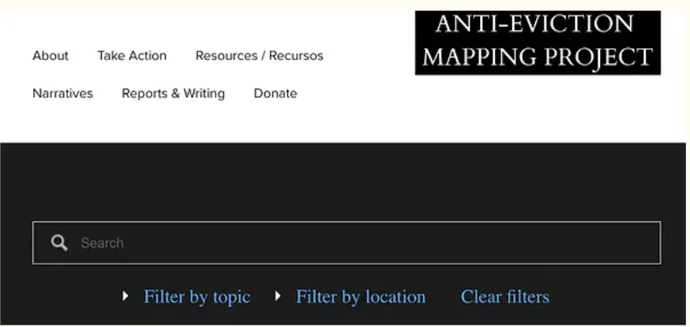

<!-- METADATA and FORMATTING: all required fields have been added into a table plus Status: hidden; no Issue field. A table is also used here to better organize the metadata and improve readability. The abstract section relates the article to the relevance of "Navigating Digital Anxieties" in the CRTL+ALT+DH upcoming issue. Tags were also added based on the tags actively in use in the CTRL+ALT+DH filtering system so that this article corresponds accordingly. -->

Sections:
- Introduction 
- Data Activism
- The Argument
    - Moblizing and Visualizing the Data
    - The Website Design
- References
<!-- FORMATTING: Used markdown syntax to make a nested list to indicate the sections of the article. This is an addition to the original article made possible using markdown syntax -->

## An Analysis of *The Anti Eviction Mapping Project*

<!-- STYLIZATION: Used markdown symbols for a header and italics -->

## **Identity Differences and Housing Injustice**

 <!-- STYLIZATION: Used markdown symbols to make the header bold and for header size-->

*Figure 1. Image from "Anti Evictions Mapping Project": "LA Evictions by Zip Code".*

<!-- IMAGE: converted from HPEC and resized to webp to be compatible in Markdown file. Connected image to the repository. Added alt text. Added caption that credits the source. -->

### Introduction

 <!-- STYLIZATION: Used markdown symbols to change the header hierarchy according to the connection to the body paragraphs to make the header smaller in comparison to the article title-->

["The Anti Eviction Mapping Project"](https://antievictionmap.com/) [^1] is a digital project that can use the framework provided by Temi Odumosu in the article ["The Crying Child: On Colonial Archives, Digitization, and Ethics of Care in the Cultural Commons"](https://www.journals.uchicago.edu/doi/10.1086/710062)[^2], drawing from the ideas that focus on the implementation of the ethics of care which aim to contextualize in a way that fosters compassion and is essential to marginalized groups, particularly in digital archiving, storytelling, and data collection and visualization practices. An additional framework of intersectionality explained in the article ["Mapping the Margins: Intersectionality, Identity Politics, and Violence Against Women of Colour"](https://supportny.org/wp-content/uploads/2018/04/mapping-the-margins.pdf) written by Kimberlé Williams Crenshaw [^3] plays a key role as well in the understanding of the impact of this digital project on its ability to illuminate the overlap between multiple categories of identity, specifically in the context of residency systems working around or against these communities.

<!-- HYPERLINKS, FOOTNOTES: added hyperlinks to replicate how the mentions of these sources appear in the original blog post. The hyperlinks work when tested in the markdown preview. The hyperlinks connect to the Works Referenced at the bottom of the article to the corresponding Chicago citation. Footnotes are indicated using markdown syntax. The corresponding source also has the footnote indicator using the markdown syntax in the "Works Referenced" section of the article.  -->

### Data Activism

This project particularly represents differences of race, gender, ethnicity, and class, making it a depiction of intersectionality. This project functions as a response to crisises of displacement due to patterns of housing  injustice and aims to provide support and resources to those in situations at risk, as well as to bring attention to these issues of gentrification.

“The Anti-Eviction Mapping Project”[^1] is a form of data activism because it creates methods of data storytelling such as data visualizations, oral histories, and zines to use the collected eviction data to strategically challenge against the hegemonies of power such as real-estate corporations, landlords, and policy makers that are in positions to inflict and inflate the struggles of housing injustice the and protect these affected tenant communities. 

For instance, the project includes multiple interactive maps functioning as data visualizations that depict areas of eviction and displacement. Most of these maps also include details like whether the building or area was owned by a corporation, real estate trusts, the public, or an individual. With this information, a correlation can be made between the number of evictions pinpointed on the map and the proprietor in power that enforced the eviction. Returning to the framework of intersectionality, users can further find patterns between overlapping groups of minority in an area, for example, a high density of lower class black women. In doing so, the affected communities are given greater context from the included data. Using this framework prevents the simplification of the meaning behind the quantitative data used to build these maps. Instead of reinforcing these intersectional categories, the project tracks these trends of displacement and reframes it toward accountability. Using this framework, the imbalance of power is put on even greater display between these marginalized groups at the mercy of their landlords and their ability to displace them, regardless of if these landlords are corporations or individuals.  This power imbalance can be so severe that the eviction of tenants of the same community repeatedly can result in the displacement of larger intersectional communities connected through economic class status, racial gender, and ethnic identities, from an area, with little no control over the outcome themselves. They live in fear of unaffordable rents, loss of culture and community as a result of displacement, racist policing, redlining, and eviction as a culmination of these factors. With this in mind “The Anti-Eviction Mapping Project” [^1] does exactly what its name suggests; it acts as a tool for these targeted communities and individuals to reclaim their histories of housing injustices and gain greater control over what the data represents. The project helps facilitate a future where tenants no longer live with these fears due to the imbalance of power and intersectional discrimination.

### The Argument

>The grander argument of this digital project in short is that eviction is systemic, and is often profit-driven and racialized instead of being the result of individual failure. Displacement is eviction on a larger scale that impacts more than just the individual, and is a structural phenomenon rooted in political economy, racialized developments, and class inequality. “The Anti-Eviction Mapping Project” does so through a show versus tell method in a highly effective way which is emphasized through the design of the interface.

<!-- FORMATTING: used markdown syntax to make a blockquote to put greater emphasis on the claim made as it is a key part of the article as a whole. This is an enhancement I was able to make compared to the original version due to the liberties of markdown -->

Through this project, it is repeatedly proven that data is not neutral. When accompanied by the correct corresponding context and given life through an interface like the one of this project, meaning is able to be produced in ways that may otherwise be overlooked. This project does not support the preexisting narratives of eviction being isolated legal events, rather it situates these events within broader historical and economic processes like gentrification, housing speculation, and tech-driven urban change. Something these data visualizations are able to argue and communicate is the correlation between systemic powers that pressure eviction with gentrification hotspots, bringing further light to how eviction and displacement have hardly ever been independent events. “The Anti-Eviction Mapping Project” [^1] uses the flexibility of using a variety of data visualizations and storytelling methods to demonstrate that evictions cluster in economically vulnerable and often historically marginalized neighbourhoods. These methods of interpreting and presenting datasets collected from the displaced communities link these eviction patterns to local laws and real estate practices like the Ellis Act and rent control rollbacks. The interface, just like the issue at hand, invites users to explore and engage with the content instead of acting as a passive viewer. The project being composed of components that are interactive from having tools for filtering and searching through the organization’s site makes the navigation more accessible. It is also more accessible because the data representations like the use of interactive maps, timeline sliders, and zines show how the changes in eviction filings over time and space such as zip codes, neighborhoods, jurisdiction, and regional boundaries in a humanly processable way. The interface of this project allows viewers to go beyond simply seeing abstract numbers by setting the stage for them to understand eviction and displacement within marginalized communities as part of a network of socioeconomic processes. It changes the numeric data into an argument about who eviction affects and how these pressures are distributed.

#### Moblizing and Visualizing the Data

“The Anti-Eviction Mapping Project” [^1] is able to mobilize data by first collecting it from a variety of sources, including administrative data such as unlawful detainer filings collected through public record requests, public court databases, oral histories and narrative contributions from community members,  and surveys open to the affected to communities to receive their data and testimonies directly. Not only does the project collect this data, but it also makes it public, legible, accessible and interactive, for scholars and the general public in ways that it otherwise would not be. All of this data is collected and processed by the project's diverse team of volunteers of chapters who work in collaboration with tenant organizations, arts collectives, students, scholars, and the tenants themselves, working to fight against eviction. All of this culminates in the project's sub-project called the “Evictorbook” which contains a lookup tool that combines eviction data, parcel ownership data, and corporate entity data. Tools such as this, created by “The Anti-Eviction Mapping Project” [^1] mobilize data to help advocate for and connect tenants to knowledge about their rights, protections, and use this data to mobilize organized efforts to help fight displacement globally.

As previously mentioned, “The Anti-Eviction Mapping Project” [^1] the data is modelled and visualized in a multitude of ways, depending on which form is best suited in accurately and evocatively depict the data correlation within a given context. It has built interactive maps, time-series visualizations, and has combined quantitative data with media arts like film, photography, and illustration in the form of data visualizations like zines, murals, and video and written oral histories. Each of these sub-projects produced by the organization, paired with the data visualizations work to further contextualize each other by creating a wider scope to understand the issue of patterned eviction and forced displacement. By the data functioning like this and taking on this variety of forms in this digital project, the data and the way it is represented and visualized works to link and analyze the way they connect to raw patterns and lived experience and structural causes . Through these efforts, “The Anti-Eviction Mapping Project” [^1] turns quantitative data into qualitative data which allows a greater context to be applied to their research findings.

#### The Website Design

While the design of the website of this digital project does not stray from traditional web design conventions to further its impact, the implementation of these conventions actually work in its favour in making the interpretations of the data more accessible and discoverable. Two key elements of designing for the web are navigability and accessibility; two design elements which are essential for opening up modes of interpretation. Navigability refers to how well a user is able to find what they are looking for and how well an interface supports them in the discovery and engagement of its content. “The Anti-Eviction Mapping Project” [^1] website does this through the inclusion of search elements like a search bar at the top of the page, a consistent header and footer for quick access to categories of regular user destinations, and multiple search filtering options to improve the quality and accuracy of the sites navigation. The user interface of this website is fairly intuitive, and these elements help further this, particularly with how the design of the website layers its pages from being general to increasingly specific with each subpage the user continues to. These pathways connecting related pages and their associated tools and resources match the intuitive thought process of users, guiding them to further information in a clear manner, rather than users having to dig to find more detailed or relating content.

*Figure 2. Image from "Anti Evictions Mapping Project" Home page.*

Accessibility is also a key component of designing the interface of any website, but is especially vital for a website that functions as the home of information that is needed within affected communities with varying backgrounds. One of the ways the interface of this website is accessible and is able to cater to its diverse audience is that it automatically translates the text on the website into the language of the user’s browser, making its contents much more widely understandable. The interface of this website is also able to adapt to the device type being used to interact with it, thus it is not limited by the technology or browser software to function as normal, making it increasingly available to regular members of the public and academics alike.

Most of the data visualizations, as discussed previously, already have an interactive component built into them that is independent from the website design since these data visualizations are mostly developed and function using external programs which are embedded into the website for users to access. The integration of these external programs used by the organization to create many of their tools and resources is what opens up modes of interpreting the intentions of the digital project. These interactive tools allow users to interrogate the data from multiple angles: by time, geography, and pattern correlations.

 

 <!-- FORMATING: added in images using markdown formating so that the images would appear side by side, rather than one on top of the other. This is how they appear in the original blog post-->

*Figure 3. Image from "Anti Evictions Mapping Project": "San Francisco Residential Housing Ownership Map".*

*Figure 4. Image from Image from "Anti Evictions Mapping Project": "Los Angeles Ellis Act Evictions".*

The design of these data visualizations takes advantage of the digital interface rather than a printed format, meaning that it has flexibility with how it can create impact and communicate its purpose to users. It uses vivid colours to represent the data components being visualized, incorporates animation to elements to do things like demonstrate changes over time, and allows for visualizations to dynamically adapt to user input through interactions like filtering or zooming in. These elements can help portray the change and difference this data represents without solely needing to read about it or analyze the quantitative data. The ability to interact with the content used to display the data collected by “The Anti-Eviction Mapping Project” is how the organization’s primary purpose of functioning as a digital resource and tool for those at risk of eviction or community displacement opens up its ability to be well interpreted in multiple ways and by multiple people, regardless of their background.

A drawback of their website relying on a sort of web of links within their website to access and engage with the resources the organization has produced is that it is very easy for path redirection errors to occur when following a hyperlinked element. What was a big contributor to how the website is able to open up data interpretation may become a barrier to accessing the information altogether. With the project having such a depth of tools, resources, sub-projects, and data visualizations that live outside of the website itself, with the website acting primarily as a gateway to them, this potential error could be difficult for the team of volunteers to monitor, thereby accidentally foreclosing modes of interpretation

### References
 <!-- CITATIONS: Changes title of works cited section to "References" as it is more in accordance with Chicago style.-->

[^1]: “The Anti-Eviction Mapping Project.” Anti-Eviction Mapping Project. 2013. https://antievictionmap.com/. 

[^3]: Crenshaw, Kimberlé Williams. “Mapping the Margins: Intersectionality, Identity Politics, and Violence Against Women of Color.” https://supportny.org/wp-content/uploads/2018/04/mapping-the-margins.pdf. 

[^2]: Odumosu, Temi. “The Crying Child: On Colonial Archives, Digitization, and Ethics of Care in the Cultural Commons.” Chicago Journals, September 18, 2020. https://www.journals.uchicago.edu/doi/10.1086/710062. 
 
 <!-- CITATIONS: updated the reference style of source from MLA to Chicago style in accordance with the "Markdown Assignment" instructions. They connect to the footnotes as seen in the first paragraph. When previewing the markdown file, the citations rearrange in order of appearance, rather than alphabetically as used in Chicago style.-->
  <!-- REVIEW: The article has been profread and reviewed, making any appropriate changes to improve the written piece, and make it more suitable for potential submission to CTRL+ALT+DH-->