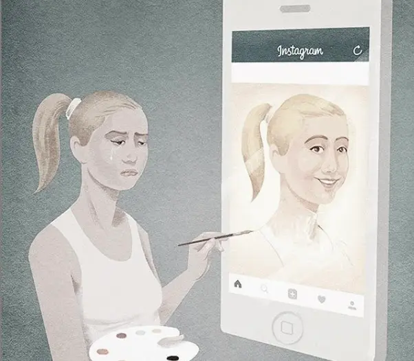

## The Digital Self vs. The Actual Self

The self is you, it is all the psychological and physical features that come together to create your identity (Attrill-Smith, 2018). The self identity can be described as the set of qualities and characteristics that gives a person their own originality especially within a social context. The thing is, a person can have multiple self identities especially when using social media. With this it can be very hard for youth to get a grasp on who they are as they're at the primary stage of developing their own self identity. Two main selves come into play here:

### 1. The digital self

A huge key feature within the usage of social media is the digital self. The digital self are the features of the self that are expressed to others through technology and social platforms. When creating your digital self (aka your profile) you may like to add details about yourself that may get others intrigued by creating your ought self which is the person we believe others want us to be, as well as our ideal self which is the self you inspire to be (Attrill-Smith, 2018) . The digital self then becomes the version of you which is shown by your posts, reposts, and how you communicate online. You may even have multiple digital selves depending on the platform and how you interact with that specific one. For youth most of their communication comes from what they say and do over social platforms, so their digital self can create most of who they think they are since youth are constantly on their phones...

### 2. The actual self

The actual self represents who we really are in any situation at any given time (Attrill-Smith, 2018). This is the real you, the person you are now and the part of you people see when you have face to face interactions in the "real world." Some people claim to not know who they truly are or who they inspire to be and sometimes attempt to be people they aren't, but you cannot change your actual self. Yes people do change over time or try to but your actual self is who you are in any given moment whether you change or not. It can especially be hard for youth to know their actual self as they are still in the midst of developing their own selves.

### The point is

Developing a self identity can be extremely hard, largely because we are now constantly throwing the perception of our self online for everyone to see (Beuken, 2016), and for youth it can be hard to be in the midst of the perception of the digital self and the actual self since they are constantly trying to discover who they are in the world. As said, the digital self is mainly brought from our ought and ideal self which as we know is not our actual self, this can create youth to try and become things they are not. Youth trying to shape their identity by things they've seen on social media is only prolonging their ability to truly understand themselves (Beuken, 2016). It is already hard enough for youth to understand themselves when going through hormonal stages and making way through different friendships and relationships, whether online or in person. We communicate differently online then we do in person which is one of the main gaps between the digital and actual self. It can be confusing for youth as they are struggling to know who they are through these different perceptions and interactions of online vs offline and can create a confused mental state of the self. Additionally, the more you interact with others the more you are able to gain a sense of self, but with youth constantly interacting through social platforms they create their sense of self through online interactions as their digital self. Since the development of the self is core in youth stages and you need vast amounts of interactions to create the self having less face to face interactions can cause youth to have problems with their sense of self, which is certainly affecting their mental well being. The digital and actual self are huge aspects when it comes to understanding who we are and it can be hard for almost anyone to get a grasp between the two, especially youth.

## The Posts...

Posts are the main aspect of social platforms. A big thing for youth when posting online is gaining peer acceptance with things such as likes and comments. Youth tend to manipulate the way they are perceived by others online to gain this peer acceptance, because when you manipulate yourself online you are trying to control how others see you in those situations (Attrill-Smith, 2018). This can become exhausting for youth as they feel pressure to get this validation, especially when the post doesn't represent who they feel they are on the inside, which just makes them feel worse. Furthermore, seeing posts on social platforms can lower youths' self worth. When youth see others looking "perfect" online it makes them feel worse about themselves by wishing that was them. Because of the way they think they are viewed youth often become fooled into thinking people's lives are better than their own (Psych Central, 2014). It's easy to manipulate the way you're viewed through social media, but when all the posts pile up it can become a problem for youth and cause real mental health disorders surrounding self worth. Youth shouldn't be bottled up in a world of posts but instead enjoying the best part of their lives.

*Figure 1. Shows how many people show a different version of themselves online. Image found on [Titled Crown](https://tiltedcrownblog.tumblr.com/post/184200241007/how-does-social-media-affect-your-self-concept). Original creator not identified.*

## The Real Impacts

Social media creates a vast amount of issues with youths' development of the self and how they view their perception of the self, and when all this accumulates it can actually cause real mental health disorders... but this should already be known. There are many disorders and factors that arise from the use of social media in youth, but I'm gonna talk about the big ones. Risky behaviours, anxiety, and depression are the main impacts here, and the worst part is all of these impacts can influence self harm.

The first one to be talked about is how social media can influence risky behaviour in youth. Research has found that being exposed to risky behaviours online corresponds with engaging in them offline, these behaviours can include; substance abuse, eating disorders, violence, self harm, and sexual activities (Attrill-Smith, 2018). Since these risky behaviours already emerge the most in youth stages, social media can increase the chances of youth participating in them from being exposed to it online. Seeing these behaviours performed online by peers or even just random people can influence youth to take part in them as they think it is socially excepted and or "cool." For example, youth viewing posts of peers drinking alcohol creates more social norms about alcohol (Attrill-Smith, 2018). With social media showing these risky behaviours as social norms more and more youth partake in them which can cause addictions and alter the brain as they aren't fully developed yet. Taking part in these risky behaviours can only lead to even more serious mental health issues, which only worsens the mental well being of youth.

Then comes anxiety. The use of social media can create youth to become anxious when online and offline. When using social media you may experience a stress response (anxiety) from negative feedback from others, cyberbullying, and becoming more aware of events occuring in the lives of others, as well as feeling pressure to keep your social networks updated (Lai et al, 2023). These anxiety factors from social media can be extremely impactful for youth as they are in primary stages of wanting peer acceptance, and since youth are constantly around peers when offline the anxiety can occur even more. In addition, youths' social status can be influenced by social media (Lai et al, 2023).  This creates social anxiety when offline because as said earlier people communicate differently online than in person, so when it comes to a social setting that isn't on a screen youth can become anxious since they are not behind their screen and or digital identity. Since the rise of social media anxiety has become extremely common among youth, more than ever before which is creating large mental impacts on this generation of youth.

Depression can be caused from social media use and corresponds with the factors above,  especially with having anxiety. It's hard to say for sure that social media causes depression but over the last decade depression in youth has risen and so has the use of social media (Miller, n.d). Effects that can be seen from the use of social media on youth is low self esteem, complications with relationships through platforms, as well youth are spending less time doing activities and spending more time online. When social media has these effects on youth it can make them feel sad, unworthy, and isolated which in the long term they can become depressed. This relates to anxiety as more youth nowadays are seen to be diagnosed with depression in result of feeling these ways more than before social media was deeply involved in youths' lives.

These are the real impacts of social media in youth and I can only imagine the rates growing more. Visit [Statistics Canada data on social media use and its impacts](https://www150.statcan.gc.ca/n1/pub/36-28-0001/2021003/article/00004-eng.htm) for some statistics on the usage and impacts of social media.

## Conclusion

Overall social media networks really do impact the mental well being of youth. Social media impacts youths' development of the self with confusion between the online vs the offline self, especially being in their primary stage of self development. As well, posting and viewing posts on social media creates self insecurities from being insecure about yourself by wishing you were someone else. All together these aspects can have really big impacts on the well being of youth, causing anxiety and depression as well as increased engagement in risky behaviours. There are many other effects that social media can have on youth but these seem to be the most important. Social media can have positive effects as well, but it seems that the bad outweighs the good.

Youth shouldn't be bottled up in a screen. Youth should be thriving with friends and enjoying their best years of life while finding who they are, but instead they're all worried about what's going to pop up on their feed next. Youth must find ways to get away from social media and remember that there is life beyond a screen and stepping away sometimes can help reconnect with the self and the world around.

**LIVING ON SOCIAL MEDIA ISN'T LIVING!!!**

## Bibliography

Attrill-Smith, A., and others. (2018, November 7). The Oxford Handbook of Cyberpsychology. Oxford Library of Psychology. [https://academic.oup.com/edited-volume/41352/chapter-abstract/352512433?redirectedFrom=fulltext](https://academic.oup.com/edited-volume/41352/chapter-abstract/352512433?redirectedFrom=fulltext)

Bueken, F. V. D. (2016, July 28). Media’s Effects on Developing Self-Identity. Trails Carolina. [https://trailscarolina.com/blog/medias-effects-developing-self-identity/](https://trailscarolina.com/blog/medias-effects-developing-self-identity/)

Del Vicario, M., Bessi, A., Zollo, F., Petroni, F., Scala, A., Caldarelli, G., Stanley, H. E., & Quattrociocchi, W. (2016). The spreading of misinformation online. Proceedings of the National Academy of Sciences. [https://doi.org/10.1073/pnas.1517441113](https://doi.org/10.1073/pnas.1517441113)

How Social Media Affects Our Self-Perception. (2014, March 14). Psych Central. [https://psychcentral.com/blog/how-social-media-affects-our-self-perception#2](https://psychcentral.com/blog/how-social-media-affects-our-self-perception#2)

Identity. (2023). Oxford English Dictionary. [https://www.oed.com/?tl=true](https://www.oed.com/?tl=true)

Lai, F., Wang, L., Zhang, J., Shan, S., Chen, J., & Tian, L. (2023). Relationship between social media use and social anxiety in college students: Mediation effect of communication capacity. International Journal of Environmental Research and Public Health, 20(4), 3657. [https://doi.org/10.3390/ijerph20043657](https://doi.org/10.3390/ijerph20043657)

## Work Consulted

Understanding the Self—The Digital Self. (n.d.). [Studocu](https://www.studocu.com/ph/document/central-mindanao-university/understanding-the-self/understanding-the-self-the-digital-self/30258699)

Institute, C. M. (2023, August 10). How Using Social Media Affects Teenagers. Child Mind Institute. [https://childmind.org/article/how-using-social-media-affects-teenagers/](https://childmind.org/article/how-using-social-media-affects-teenagers/)

Government of Canada. (2021, March 24). Canadians’ Assessments of Social Media in Their Lives. Statistics Canada. [https://www150.statcan.gc.ca/n1/pub/36-28-0001/2021003/article/00004-eng.htm](https://www150.statcan.gc.ca/n1/pub/36-28-0001/2021003/article/00004-eng.htm)

<!-- REVISION: restored the bibliography from the original essay and formatted the references for Markdown publication. -->