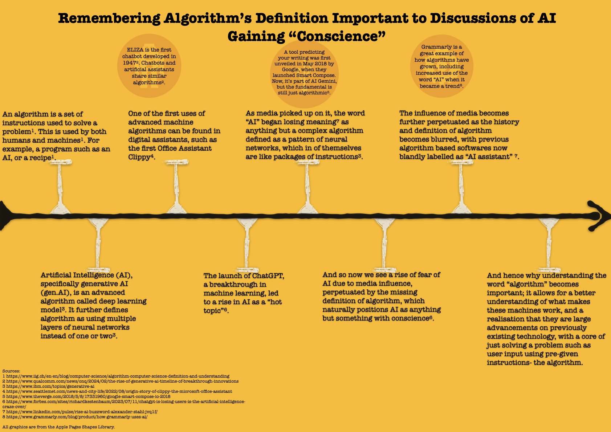

<!--Meta data is written above-->

# Remembering Algorithm's Definition Important to Discussions of AI Gaining "Conscience" - An Infographic
## An infographic arguing how a rising misunderstanding of algorithms perpetuates misperceptions of AI capabilities by analyzing the definition of an algorithm, and exploring the rebranding of numerous algorithms into an “AI assistant” due to rising media and marketing influences.
### By Amir Benkelai
<!--Styling is used to create different headers-->

<!--Image is embedded using a HTML block to feature a caption. The original website did not have alt text nor a caption. Those are new additions.-->
<fig>
     </img>
    <figcaption> Figure 1: A timeline about the development of the algorithm and how the word's meaning changed over time. </figcaption> <!--Including a caption-->
</fig>

  <!--Creating a line break to make space between content and caption of the image-->

This infographic was inspired by the timeline style except that it lacks specific dates because the timeline element is used here as a graphical way to neatly present the argument, hence why there is an arrow at the end and a beginning tip.

In terms of information, it had to be rather condensed, in order to fit into the timeline but also the infographic. This was difficult to achieve, and so was countered by featuring the three circles that provide examples to further build upon some of the given points. However, here there is also the issue that certain definitions had to be ommited, for example what a neural network is, because of space, but also as it was beyond the aims of the infographic. Visually, it was inspired by the palette of [Clippy](http://www.seattlemet.com/news-and-city-life/2022/08/origin-story-of-clippy-the-microsoft-office-assistant)[^1] <!--This hyperlink does not exist in the original. A new addition to meet the requirements of the assignment.-->, where the interest for this first sparked. Unfortunately, the yellow was not working as well due to contrast clash with hues of black/grey, and white, thus why a hue of orange had to be picked out.

Last, this infographic was a great application of previous design principles, but also newly learnt knowledge of how to make data visualizations work. Having to pick out specific information, decide what is and isn’t included, which graphical palettes work and don’t work, and varying ratios, all provided greater understanding of how interactions with visualizations like infographics function. As well, there was new learning of how [algorithms](https://en.wikipedia.org/wiki/Algorithm) <!--This hyperlink does not exist in the original. A new addition to meet the requirements of the assignment.--> have shifted over the years, into the new paint label “[AI](https://en.wikipedia.org/wiki/Artificial_intelligence)” <!--This hyperlink does not exist in the original. A new addition to meet the requirements of the assignment.-->.

## Footnotes <!--The lack of index numbers in the text is because the citations below in Works Cited are for the infographic's content, which was not changed for the assignment. The source on Clippy is used to test footnotes function. I realised too late I should have chosen a different assignment to turn into Markdown for this assignment.-->

[^1]: Cassidy, ‘The Twisted Life of Clippy’.

## Works Cited <!--Styling the header-->

<!--The original was cited in MLA. Converted to Chicago for the assignment.-->

Apple Inc. *All Graphics Are from the Apple Pages Shapes Library*. In Pages. n.d.

Cassidy, Benjamin. ‘The Twisted Life of Clippy’. Seattle Met, 23 August 2022. [https://www.seattlemet.com/news-and-city-life/2022/08/origin-story-of-clippy-the-microsoft-office-assistant](https://www.seattlemet.com/news-and-city-life/2022/08/origin-story-of-clippy-the-microsoft-office-assistant).

Deahl, Dani. ‘Gmail’s Smart Compose Will Write Emails for You’. The Verge, 8 May 2018. [https://www.theverge.com/2018/5/8/17331960/google-smart-compose-io-2018](https://www.theverge.com/2018/5/8/17331960/google-smart-compose-io-2018).

Grammarly. ‘How We Use AI to Enhance Your Writing | Grammarly Spotlight’. Grammarly.Com, Grammarly, 14 August 2019. [https://www.grammarly.com/blog/product/how-grammarly-uses-ai/](https://www.grammarly.com/blog/product/how-grammarly-uses-ai/).

International Institute in Geneva. ‘Algorithm & Computer Science: Definition and Understanding’. IIg.Ch, International Institute in Geneva. Accessed 26 October 2024. [http://www.iig.ch/en-en/blog/computer-science/algorithm-computer-science-definition-and-understanding](http://www.iig.ch/en-en/blog/computer-science/algorithm-computer-science-definition-and-understanding). <!--I found out this link now redirects to iig.ch/news. The original source may be accessible using the Wayback Machine.-->

Kestenbaum, Richard. ‘ChatGPT Is Losing Users. Is the Artificial Intelligence Craze Over?’. Forbes, 11 August 2023. [https://www.forbes.com/sites/richardkestenbaum/2023/07/11/chatgpt-is-losing-users-is-the-artificial-intelligence-craze-over/](https://www.forbes.com/sites/richardkestenbaum/2023/07/11/chatgpt-is-losing-users-is-the-artificial-intelligence-craze-over).

Lawlor, Pat, and Jerry Chang. ‘The Rise of Generative AI: A Timeline of Breakthrough Innovations’. Qualcomm.Com, 12 February 2024. [https://www.qualcomm.com/news/onq/2024/02/the-rise-of-generative-ai-timeline-of-breakthrough-innovations](https://www.qualcomm.com/news/onq/2024/02/the-rise-of-generative-ai-timeline-of-breakthrough-innovations).

S., Alexander. ‘The Rise of AI as a Buzzword’. Linkedin.Com, LinkedIn, 10 December 2023. [https://www.linkedin.com/pulse/rise-ai-buzzword-alexander-stahl-jvq1f](https://www.linkedin.com/pulse/rise-ai-buzzword-alexander-stahl-jvq1f).

Stryker, Cole, and Mark Scapicchio. ‘What Is Generative AI | IBM’. Ibm.Com, IBM, 22 March 2024. [http://www.ibm.com/topics/generative-ai] (http://www.ibm.com/topics/generative-ai).