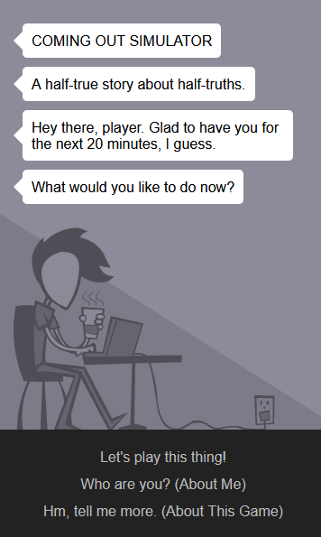

# Analyzing Digital Stories: Coming Out Simulator

Welcome back to the café! It’s been a little while, hasn’t it? ☕

While you sip your drink on this *fine* evening in the digital cyberspace, I’ll give you my usual chat. You’ll notice that this post is actually part of a duo of posts, all centred around me covering online stories about young LGBTQ+ people trying to find their identities. I wanted to see how different formats of storytelling affect the overall emotion and understanding that people get. So for this post, I’m covering…

[Coming Out Simulator by Nicky Case!](https://ncase.itch.io/coming-out-simulator-2014)[^1]

Format: Interactive Story with Visual Elements

## Tom's Thoughts

This story was quite a personal one. It covers a semi-fictional version of the game’s creator, on the night in 2010 that she came out to her parents as bisexual. I’ll admit off the bat that I have a personal bias towards this one, as I’ve been a big fan of Nicky Case and her work for a long time. *Adventures with Anxiety!,[^2]* another interactive story she made 5 years after this one, had a strong and memorable impact on me when I played it a few years ago. I’ll try not to let too much bias show as I chat here.

Like with AWA, this a game where you choose simple dialogue options for a player character that progress a story, quickly leading to the story remembering your choices and having a strong impact on the plot. That sounds like most interactive stories, but what quickly sets COS apart is how effectively the art direction, sound design, and writing style quickly get you into the headspace of the characters. The way that the entire duration of the coming out scene makes you feel so overwhelmingly uncomfortable, with the framing putting Case and her mom so distantly awkward and apart, the character designs’ lack of faces making it so much harder to read the emotion, and the constant ticking of the cat clock *making my discomfort levels FALL UP AN ESCALATOR,* it feels easy to forget that you’re not the protagonist of the game and that you aren’t directly experiencing the things that Case actually went through. And that’s really helpful for a lot of audiences! Especially for people like me, who do not have demanding parents that have exact requirements for who their kids need to be as people in order for them to be accepted and not criticized, this kind of immersive story can give me empathy for people where before I previously would only have been able to give sympathy.

If I had to give a few pointers, one thing that immediately stuck out to me in contrast from Case’s later work was how all of the dialogue progressed automatically. For reference, games and other storytelling mediums with dialogue boxes usually give the player the option to press a button or click to advance to the next text box. This is a standard accessibility option for a multitude of reasons that I don’t have time to go into here, but it’s safe to say that it makes this story harder to get into for quite a few people, when otherwise it felt like just about anyone could have played this. I also found my personal disconnect between the player’s dialogue with Case at the beginning and end to be quite distracting, but I can also see how that would have been intentional to show Case’s mental state.

Overall, I loved this one. It was heavy, but the medium worked wonders to immerse the reader and convey the message!

## CITATIONS

[^1]: Case, Nicky. “Coming Out Simulator.” Itch.Io, 30 June 2014, <https://ncase.itch.io/coming-out-simulator-2014>.

[^2]: Case, Nicky. “Adventures With Anxiety!” It’s Nicky Case!, 10 Dec. 2019, <https://ncase.me/anxiety/>.
