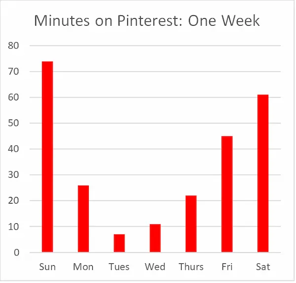

# The Quantified Self: A *Pinterest* User Data Analysis

## Introduction

This study will focus on *Pinterest* as an online social media platform shaping online discourse, its role in building a sense of community or creating and amplifying divisions and discord, and how this has produced my online persona: my “data double”.  Data surveillance and capitalism, artificial intelligence, and algorithms, all have influence over Pinterest’s policies which emphasize the platform’s mission to create a positive and creative online space to inspire users to live their “best” lives.  These theories have formed how I use online platforms and control my data.  This study will show how *Pinterest* has shaped my personal online presence.

## Functions of *Pinterest*

 **Figure 1**

*Pinterest* has a very simple design both in aesthetic and navigation.  (See Figure 1).  The homepage has a white background, search panel and navigation panel, and the rest of the platform essentially consists of images and videos posted by users called “pins”.  This design allows for the user to explore and navigate the platform by their own whims, each image or video prompting a unique inspiration.  The search bar affords further variety when searching for pins and includes “Daily Inspiration” tabs on the explore page with topics to check out (ex. “Trending Now: Fashion forward home décor”).  The user’s profile consists of “boards” (kept personal or private) to save pins on in a personally organized way.  The user is able to browse for inspiration, save it, send it to friends on the app or texting a link, and comment on pins they appreciate or create their own.  The design overall invites the user to search for pins that appeal to them.  Each pin has a caption, a like button and counter, a button to share with other users, a button to comment, and a red button to save a pin to a board.  These are straightforward user interactions: save, like, comment or share the pin.  Pinterest’s simplistic aesthetic encourages inspiration and creativity over popularity.  Even though the user is afforded buttons to like, comment, share, etc., these features are plain, small details overshadowed by the pin itself.  Only one comment can be seen by initially clicking on the pin—the user must seek out the comments to read other’s opinions.  Furthermore, these features are not visible until the user selects a pin to view—only the pin’s caption is observable, which most pins lack anyway, allowing the image or video to speak for itself.  Unlike Instagram, the username, likes, comments, popular posts are not the allure of *Pinterest*; inspiration and creativity drives the user.  Because of this, visualization is the discourse.  Unlike other platforms that are text-heavy, *Pinterest* relies on visual communication, prompting the users by showing desirable images instead of stimulating argument and debate.  This emphasizes Pinterest’s mission surrounding creativity and inspiration.  Comparatively, while Instagram is also visual focused it includes several lines of text below images for comments, likes, shares; and invites the user to investigate comment sections; versus *Pinterest* which requires the extra step of tapping the pin before a single comment appears and then opening the comment section becomes available.  Inspiration of a “better” life is what prompts and alters user behavior using visual cues.  Visual cues, especially in a simplistic aesthetic platform like *Pinterest*, can appear passive and give a sense of control to the user, however these prompts are controlled by the *Pinterest* algorithm.

## Surveillance Capitalism in *Pinterest*

Zuboff states that “surveillance capitalists discovered that the most predictive behavioural data come from intervening in the state of play in order to nudge, coax, tune, and herd behavior toward profitable outcomes” (2019), which can be seen in *Pinterest*’s “Rich Pins” feature.  This feature lists the pin as a purchasable item, so the user can refer to prices and view links to shop for the item.  Additionally, in 2014 *Pinterest* released its advertising program which allowed organizations to use pins on the platform to promote their business with promoted pins but still kept the platform free to users.  The algorithm offers advertisement pins similar to others a user has saved or clicked on.  By using user data, the algorithm interferes with the “state of play” (*Pinterest*’s homefeed) to persuade users to buy whatever *Pinterest*’s sponsor is advertising through predicting what the user will see as desirable, shaping user behaviour.  Gilbert et al. noted this effect in a market survey which showed, “a higher proportion of *Pinterest* users click through to e-commerce sites, and when they go there, they spent significantly more money than people who come from sites like Facebook or Twitter” (2427).  Over the years, *Pinterest*’s even introduced an A.I. called “*Pinterest* Lens” to identify objects and find other pins with similar objects (Weston, 2023).  This feature promotes consumerism and shopping via *Pinterest* because sponsored pins with links to online purchasing will appear.  This is how surveillance capitalist use data to change human behaviour to earn a profit through *Pinterest*.
Additionally, through data assemblage and surveillance capitalism, Haggerty describes a “data double”, which is essential a virtual replication of oneself used to study behavioural patterns.  This is not isolated to social media, and Haggerty states it is data collected from multiple platforms.  This is valuable to studying trends so platforms can market according to what will be most desirable.  Therefore, this data double is sellable material, as Haggerty describes, “The monetary value of this surplus derives from how it can be used to construct data doubles which are then used to create consumer profiles, refine service delivery and target specific markets” (616).  See (Figure 2) for an example of the ratio of promotional pins based on a random sample from my *Pinterest* feed.  Out of 17 pins visible on the screen, 6 are sponsored items.  That indicates that on average roughly 35% of pins visible on a desktop are used for *Pinterest*’s monetary gain.  Some of the sponsored pins are so similar to regular pins that they blend with feed.  The way to know they are sponsored is the claim underneath the caption of the pin, stating “Sponsored”.

 **Figure 2**

## Data Collection and Policies

User data collected is compiled of information permissible for *Pinterest* to use through their terms and conditions, and privacy policy.  For example, “Device information: We collect information about the device you use to access our Services, including the type of device, operating system, network service provider, settings, and unique device identifiers.” (Privacy Policy, *Pinterest*).  The algorithm is trained on user data and information such as pins saved, commented on, shared, posted, and viewed, but also from user profiles and devices.
Data is also collected for safety of *Pinterest* users and maintaining *Pinterest*’s reputation.  *Pinterest* has an important content policy, which encourages users to report any posts they feel should not be seen on the platform and states, *Pinterest* isn’t a place for antagonistic, explicit, false or misleading, harmful, hateful, or violent content or behavior” (Policy, *Pinterest*).  They remove profiles and groups of violent actors.  Content they do not allow also includes promotion of products associated to animal or human cruelty, alcohol, drugs, etc.  Exploitation of financial and labour practices are prohibited.  Anything that spreads private information or imposes a threat to the safety of oneself or others will also be removed, misinformation as well.  It is also not a place to claim or steal anyone’s intellectual property.  *Pinterest*’s policies have last been updated in December of 2025.  These policies are in place to uphold *Pinterest*’s ideals and values of creating a positive platform where users can express themselves without hate or judgement.  The platform’s mission, “*Pinterest*'s mission is to bring everyone the inspiration to create a life they love” (Privacy Policy, *Pinterest*), depicts that everyone is equal on their platform because their intent is for everyone to be inspired to create a better life.  The voices they silence are ones who do not abide by their policies which prohibit inappropriate or ill-willed content.  Creativity and inspiration are celebrated on the platform.  In their transparency statement it states, “Our moderation practices are always evolving to keep up with new behaviors and trends and to create a more positive corner of the internet for the people on our platform. We continue to invest heavily in measures like machine learning technology to fight policy-violating content on *Pinterest* (Transparency, *Pinterest*).  Without those “machine learning technologies” which rely on user data, there would be an increase in policy violators that go undetected.  *Pinterest* and its users would be exposed to inappropriate content and may be subjected to hate.  This is an example of how data collection is beneficial to social media platforms.  To critique *Pinterest* policies, however, the Terms and Conditions contains a statement that reads, “You may use *Pinterest* only if you follow these Terms and all applicable laws” (Terms and Conditions, *Pinterest*), and also later indicates the user must be over the age of thirteen at least (and the required age of the country they live within).  Adding the words “and all applicable laws” is vague and can be misleading.  “Applicable” indicates any laws that are reasonably relevant, but deciding what laws are applicable to *Pinterest*’s Terms and Conditions can be subjective to a situation or person.  Perhaps it refers to the citizenship of the user; but if so, why not state it explicitly?  The statement allows for other laws of which are not written within the Terms and Conditions to apply to the agreement.  These Terms and Conditions were most recently updated April 2025.  Additionally, the policies and terms and conditions are methods in which *Pinterest* is shaping the discourse of their platform.  It restrains what is said and posted, but it also encourages and protects a positive and welcoming environment which promotes their reputation and user engagement.  It’s their policies that allow them to ensure “*Pinterest* is a visual search and discovery platform where people find inspiration, curate ideas and shop products—all in a positive place online” (The *Pinterest* Newsroom, *Pinterest*).  They back this claim through the construction of their platform’s features as well as their settings and support, which has several options to customize and filter users’ personalized ads and recommendations.  *Pinterest* adheres to the user’s interests first and foremost.

## My Data Double

 **Figure 3**

To understand my personal “data double”, I requested my data collected by *Pinterest* over the last year.  Within this request there were 27 available categories of which *Pinterest* could capture information from using the platform: “About your download”, “General information”, “User profile information”, “Other user information”, “User sessions”, “Boards”, “Pins”, “Notes”, “Comments”, “Tried-Its”, “Followees”, “Followers”, “Boards followed”, “Conversations”, “Blocked users”, “Search history”, “Homefeed data”, “User events”, “User autofill data”, “Contact Forms”, “Shopify store information”, “Shuffles created by the user”, “Shuffles comments created by the user”, “Shuffles Conversations”, “Shuffles user data”, “Ads blocking”, “Reported pins”.  Of these 27 categories, only 12 contained any data to view from my profile. See (Figure 3).  The remaining 15 claimed there was “No data” applicable to the category.  Partially this is due to my own personal privacy preferences while using social media.  Specifically, I do not comment on *Pinterest*.  I do not have a profile picture.  I do not create pins or make my boards visible.  I do not shop.  The data collected in this request consists mostly of pins saved, boards I have created, my two followers and followees, and my profile information such as usernames, name, and email address.  Any other data (outside of these 27 categories) was not offered within the request for my study.

<!--Spaces added between paragrpahs for the figure, but they belong under the same section; therefore no heading-->

 **Figure 4**

From my own data collection, I documented the time I spent on *Pinterest* in an average week.  See (Figure 4).  I have a time limit set on my social media that creates a “block” when I have exceeded the allotted time on a specific platform, which was set earlier this year.  It has limited me to 2 hours of *Pinterest* daily, however I have noted that since setting the limit, I rarely pass it.  For seven consecutive days I recorded how many minutes I spent on *Pinterest* and totalled them at the end of the day.  Over the week I accumulated 246 minutes or 4.1 hours on *Pinterest*, which would average about 35 minutes a day.  The graph, however, clearly indicates I spend longer on *Pinterest* during the weekends during leisure time rather than throughout the school week.  This makes sense, as social media is not a priority for myself, and I rarely communicate on *Pinterest*, whereas I may use another platform like Instagram for group projects with peers throughout the day, which would indicate I need less time per day *Pinterest* during school.
I have studied communications, culture, and technology for several years, and even before then I was taught to be very careful with my online presence.  Understanding what happens to my data and how it can be used to prompt my actions has made me aware of how to provide as little data as possible to social media platforms and allowed me to minimize my data double.  From my experience, *Pinterest* is an entertaining platform to explore art, find wallpapers and send pins I think my friends the (two followers/followees) would enjoy.

## Bibliography

<!--Links in bibliography titled "Link access" or "DOI" to meet assignment requirement of link formatting-->
<!--Fixed so the formatting is proper.-->

Gilbert, Eric, et al. “I Need to Try This?: A Statistical Overview of Pinterest.” *Proceedings of the SIGCHI Conference on Human Factors in Computing Systems (CHI ’13)*, Association for Computing Machinery, 2013, pp. 2427–2436. [https://doi.org/10.1145/2470654.2481336](https://doi.org/10.1145/2470654.2481336)

Haggerty, Kevin D., and Ericson, Richard V. “The Surveillant Assemblage.” *The British Journal of Sociology*, vol. 51, no. 4, 2000, pp. 605–622. [https://doi.org/10.1080/00071310020015280](https://doi.org/10.1080/00071310020015280).

*Pinterest*, [https://ca.pinterest.com/](https://ca.pinterest.com/). Accessed 8 April 2026.

Pinterest. *Newsroom*. Pinterest, [https://newsroom.pinterest.com/en-ca/](https://newsroom.pinterest.com/en-ca/). Accessed 8 April 2026.

Pinterest. *Privacy Policy*. Pinterest, 30 Apr. 2025, [https://policy.pinterest.com/en/privacy-policy](https://policy.pinterest.com/en/privacy-policy). Accessed 8 April 2026.

Pinterest. *Terms of Service*. Pinterest, 30 Apr. 2025, [https://policy.pinterest.com/en/terms-of-service](https://policy.pinterest.com/en/terms-of-service). Accessed 8 April 2026.

Pinterest. *Transparency*. Pinterest, [https://policy.pinterest.com/en/transparency](https://policy.pinterest.com/en/transparency). Accessed 8 April 2026.

Weston, Zachary. “Title: A Journey Through Time — The History of Pinterest.” *Medium*, 28 July 2023. [https://medium.com/@zacharywestonintech/title-a-journey-through-time-the-history-of-pinterest-5770b700b45c](https://medium.com/@zacharywestonintech/title-a-journey-through-time-the-history-of-pinterest-5770b700b45c).  

Zuboff, Shoshana. *The Age of Surveillance Capitalism: The Fight for a Human Future at the New Frontier of Power*. 1st ed., PublicAffairs, 2019. *EBSCOhost*, [https://research.ebsco.com/linkprocessor/plink?id=3318392d-74e2-3edc-a8de-6cb3b09d2c63](https://research.ebsco.com/linkprocessor/plink?id=3318392d-74e2-3edc-a8de-6cb3b09d2c63).
