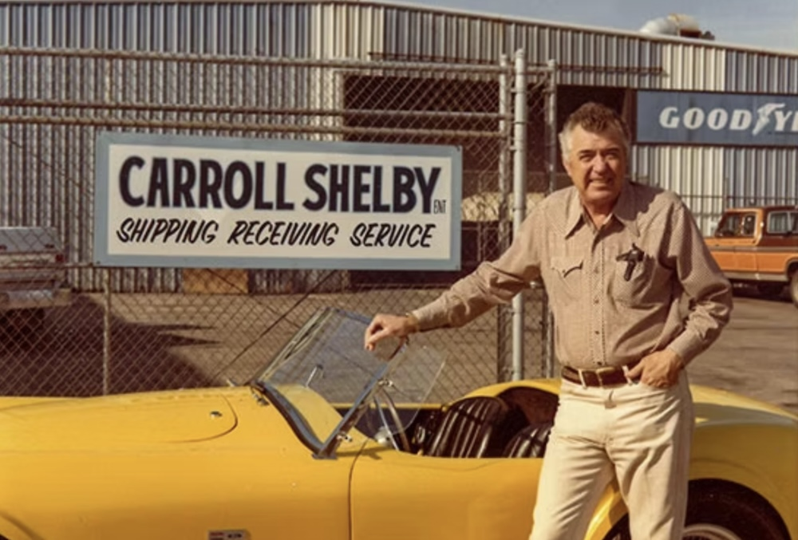

# History of Carroll Shelby

*Carroll Shelby pictured beside a yellow sports car.*

Carroll Shelby was an American automotive designer, racing driver, and entrepreneur. He is best known for his work with high-performance cars, including the AC Cobra and Shelby Mustang.
## The Timeline
The following timeline consists of the history of the following Caroll Shelby and his journey throughout his life. The timeline covered everything from his early childhood and his racing career to his retirement. After Caroll Shelby retired, he still made a big impact on his community by starting the Caroll Shelby Foundation, which helps provide assistance for acute coronary and kidney care for young people who share many of the same afflictions.

## Interesting Facts
Some interesting facts I found throughout my research are that Shelby is best known for his involvement with the AC Cobra, Mustangs, and the Shelby car. Carroll Shelby built this car and made it high-performance. Another interesting fact that I found was that Carroll Shelby studied Aeronautics at the Georgia Institute of Technology, where he developed an interest in cars and their technology. My favourite fact was that Carroll Shelby made the Ford GT40 and took the Ford to Le Mans for a 24-hour race, and he helped them beat Ferrari.[^1] I had never expected that he would be capable of doing this, and the Ford GT40 is still sold today with new models and engineering. Finally, another thing that struck me was that Shelby decided to help Dodge because they are Ford's competitor. His helping Dodge and eventually making the Viper come into existence greatly improved Dodge for who they are even to this day. Nowadays, Dodge has incredibly focused on building performance vehicles such as the Hellcat and Dodge Demon, and these wouldn’t have happened because Dodge didn’t join the vehicle performance industry without Shelby’s help.

> Shelby's legacy connects motorsport, automotive design, and high-performance cars.

Key vehicles associated with Shelby's legacy include:

- AC Cobra
- Shelby Mustang
- Ford GT40
- Dodge Viper

## Reflection
During the making of this timeline, I learned many new things. Firstly, using Google Sheets to make a timeline was new to me since I had never done that before. One thing I enjoyed during this process was collecting the information for my assignment and mapping it out. I enjoyed this because I am very passionate about learning the history of Carroll Shelby, his career, and how he inspires the creation of high-performance cars.

One challenging thing during the making of the timeline was that if I forgot to include a timeline entry between two years, it would not let me add a new row. Instead, I had to copy and paste a row, which I found to be a minor inconvenience. One easy thing I found was adding pictures to the timeline, which required me to copy and paste the link into the media column.

Overall, I enjoyed the whole process of doing this assignment. It helped me enhance my research and organization skills.

## Bibliography
“Foundation News.” *Shelby Foundation*. Accessed February 1, 2024. [Shelby Foundation](https://www.shelby.com/ShelbyFoundation).

Seabaugh, Christian. “Carroll Shelby’s Life, 1923–2012 Timeline.” *MotorTrend*, May 11, 2012. [Read the article](https://www.motortrend.com/features/carroll-shelby-life-1923-2012-timeline/).

“Carroll Hall Shelby.” *Shelby American Inc.*, History. Accessed February 2, 2024. [Shelby History](https://www.shelby.com/History).

“Carroll Shelby.” *Automotive Hall of Fame*. Accessed February 1, 2024. [Read the profile](https://www.automotivehalloffame.org/honoree/carroll-shelby/).

“Carroll Shelby at the 24 Hours of Le Mans Race, June 1966.” *The Henry Ford*. Accessed February 1, 2024. [View the artifact](https://www.thehenryford.org/collections-and-research/digital-collections/artifact/410597/).

Elise. “The Story of 20th-Century Midas: Carroll Shelby.” *Muscle Car*, March 8, 2021. [Read the article](https://musclecar.uk/history/the-story-of-20th-century-midas-carroll-shelby/).

## Timeline

This page explores key moments in Shelby's life, his automotive achievements, and his legacy.

### Interactive Timeline

[Explore the Carroll Shelby timeline](https://cdn.knightlab.com/libs/timeline3/latest/embed/index.html?source=1KZ50wTF3AC3oLZVnW9sonPkfaqKwaUXeTr7uFQEsNVE&font=Default&lang=en&initial_zoom=2&height=650)

<!-- First draft: I will expand the timeline, add images, citations, and reflection. -->

[^1]: The Henry Ford, “Carroll Shelby at the 24 Hours of Le Mans Race, June 1966,” https://www.thehenryford.org/collections-and-research/digital-collections/artifact/410597/.
<!-- Revision note: Added Markdown formatting, an image and caption, an interactive timeline, and a footnote. -->
