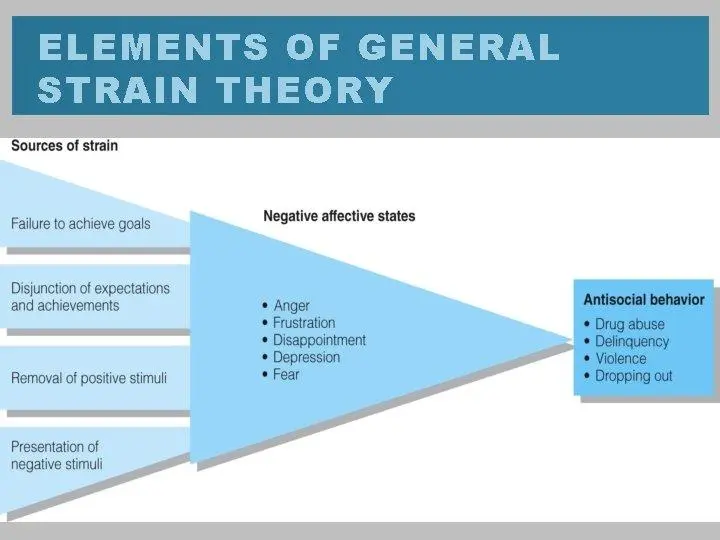

# A Deeper Dive and Critique of Agnew's General Strain Theory

## Introduction

Agnew's **General Strain Theory (GST)** is a strong explanation of how stressors cause crime, yet its broad definitions, subjectivity, and lack of emphasis on structure are grounds for concern about its general effectiveness.

Although strain can lead to delinquency, several factors condition this effect including parental relations, peer groups, and coping mechanisms.

GST is more general and adaptable than other strain theories because it acknowledges a larger variety of stressors and explains why only some individuals engage in crime. However, its limitations, most significantly regarding coping mechanisms, the distinction between objective and subjective strain, and how it handles gender difference, detract from its explanatory power.[^1]

<!-- Added my title, information, and introduction from my original essay. -->

*Figure 1. General Strain Theory model. Created by U3201217 (2021), [Wikimedia Commons](https://commons.wikimedia.org/wiki/File:General_Strain_Theory_(GST)_Model.png), CC BY-SA 4.0.*

<!-- Added an image of General Strain Theory with a caption. -->

## Coping Mechanisms

One of the biggest flaws of GST is that it doesn't properly study **coping mechanisms**. While Agnew classifies coping mechanisms as emotional, cognitive, and behavioural responses, there is no clear explanation in the theory for why individuals employ specific coping mechanisms and not others. Emotional coping, for instance, like suppressing or diverting anger, varies significantly depending on individual and social factors and no consideration is given to how these factors affect a person's coping style.[^2] Similarly, cognitive coping, is a question of perception alteration of strain, is not directly linked to criminology's decision-making and learned behaviour theories. Negative emotion based on strain is presumed to cause crime unless managed by the individual properly, but there is no clear framework for predicting how individuals will react differently.[^3]

GST's cognitive, emotional, and behavioural processes of coping mechanisms are not well developed to account for why strain causes crime for some individuals and not others. Emotional response to strain, particularly anger, is generally identified as a key cause of crime.[^3] However, GST is not able to provide a detailed exploration of emotional control or regulation of offending behaviour-related impulses that are crucial to whether or not crime results from anger. The cognitive mechanism that involves offending behaviour rationalization as a response to strain is superficial in explaining how individuals rationalize crime based on what is around them. Lastly, the behavioural mechanism argues that exposure to strain increases the offending behaviour likelihood, while GST is not able to account for crime-reducing factors such as strong family relationships or community support.[^4]

## Subjective and Objective Strain

Another weakness of GST is how it deals with *subjective versus objective strain*. Objective strain consists of universally recognized stressors such as abuse or poverty, while subjective strain is based on individual perception. According to the theory, individuals who perceive that they are experiencing unfair strain are more prone to crime, yet it doesn't do a good job of explaining why individuals perceive that they are experiencing unfairness and others do not. This weakness detracts from the potential of the theory to make accurate crime predictions. Cultural background, individual expectations, and prior experience affect individuals' perception of strain, yet GST doesn't do a good job of addressing these factors in its theory.[^1]

## Gender Differences

Another shortcoming of GST is that it deals with gender differences. Although Agnew acknowledges that males and females experience and respond to strain differently, with males experiencing physical abuse and females experiencing sexual abuse, the theory doesn't go deep enough into how gender norms and socialization affect these responses. Studies show that males externalize strain through aggression and delinquency and that females internalize it and experience it as depression or substance abuse. By not addressing these to some extent, GST oversimplifies crime and strain. Further, the theory doesn't consider how structural inequalities in access to coping resources influence gendered responses to strain. This is yet another shortcoming that diminishes its explanatory power.[^3]

## Structural Inequalities

Another significant shortcoming of GST is that it has a shortage of structural emphasis. While the theory acknowledges that strain is present in social contexts, it is not sufficient to address how systemic forces shape individual strain. Marginalized communities, for example, are frequently subjected to chronic strain through economic disadvantage, discrimination, or violence in their communities. GST is not sufficient to account for how long-term exposure to systemic disadvantages can impact coping mechanisms or offending behaviour. The theory is still individual psychological processes-oriented and does not consider larger society-wide influences that condition responses to strain.[^3]

## Social Learning and Social Control

Also, GST doesn't adequately address the role of *social control and social learning* in shaping how individuals respond to strain. Other theories of criminology, such as social learning theory, emphasize that behaviour is acquired through social contact with others and social groups. GST, by contrast, outlines strain as a cause of emotional distress and crime without explaining how individuals can learn coping responses from their environment. Likewise, social control theory asserts that effective social bonds deter delinquency, and this is not addressed by GST in explaining why some people become criminals and others do not. By excluding these external influences, GST oversimplifies the link between strain and crime.[^5]

## Practical Applications

The practical applications of GST are also limited. While it is theorized that strain can reduce crime rates, it doesn't provide detailed methods for intervention. Strain is a general and self-reporting construct and is thus almost universally felt to some degree by nearly anyone. Not everybody is a criminal, though. GST doesn't say what kinds of strain to target for prevention or what coping mechanisms to encourage. Other theories such as routine activity theory are more prescriptive for crime prevention than GST, which is more theoretical. This limits it for policymakers and practitioners who are concerned with effective crime reduction.[^6]

## Conclusion

In short, while General Strain Theory is effective in describing how stressors cause crime, its limitations reduce its overall strength. The theory is unable to account for coping mechanisms, how subjective and objective strain interact with each other, and how structural inequalities influence crime. Further, GST's handling of gender differences and the absence of clear policy prescriptions also reduces its usefulness. While GST has opened up criminology by broadening the scope of strain theories, it still has to be refined to provide a more specific and useful explanation for crime. Making GST's focus on structural inequalities more detailed, elaborating on its handling of coping mechanisms, and specifying its distinction between subjective and objective strain would make it a more effective explanation. Without these developments, GST is a useful but unfinished framework for explaining crime.

<!-- Added footnotes and changed some of the text to bold and italics. -->

## Bibliography

Agnew, Robert. "[Using General Strain Theory to Explain Crime in Asian Societies](https://doi.org/10.1007/s11417-014-9198-2)." *Asian Journal of Criminology* 10, no. 2 (2015): 131–47.

Agnew, Robert. "[Reflection on 'A Revised Strain Theory of Delinquency'](https://doi.org/10.1093/sf/sos117)." *Social Forces* 91, no. 1 (2012): 33–38.

Agnew, Robert. "[When Criminal Coping Is Likely: An Extension of General Strain Theory](https://doi.org/10.1080/01639625.2013.766529)." *Deviant Behavior* 34, no. 8 (2013): 653–70.

Agnew, Robert, Timothy Brezina, John Paul Wright, and Francis T. Cullen. "[Strain, Personality Traits, and Delinquency: Extending General Strain Theory](https://doi.org/10.1111/j.1745-9125.2002.tb00949.x)." *Criminology* 40, no. 1 (2002): 43–72.

Mazerolle, Paul, Velmer S. Burton Jr., Francis T. Cullen, T. David Evans, and Gary L. Payne. "[Strain, Anger, and Delinquent Adaptations Specifying General Strain Theory](https://www.sciencedirect.com/science/article/abs/pii/S0047235299000410)." *Journal of Criminal Justice* 28, no. 2 (2000): 89–101.

Yıldız, Muhammed, and Özgür Solakoglu. "Strain, Negative Emotions, and Suicidal Behaviors Among Adolescents: Testing General Strain Theory." *Journal of Youth and Adolescence* 48, no. 4 (2019): 639–657.

<!-- Added hyperlinks to the sources in my bibliography. -->

[^1]: Robert Agnew, "Using General Strain Theory to Explain Crime in Asian Societies," *Asian Journal of Criminology* 10, no. 2 (2015): 131–47.

[^2]: Paul Mazerolle et al., "Strain, Anger, and Delinquent Adaptations Specifying General Strain Theory," *Journal of Criminal Justice* 28, no. 2 (2000): 89–101.

[^3]: Robert Agnew, "Reflection on 'A Revised Strain Theory of Delinquency,'" *Social Forces* 91, no. 1 (2012): 33–38.

[^4]: Muhammed Yıldız and Özgür Solakoglu, "Strain, Negative Emotions, and Suicidal Behaviors Among Adolescents: Testing General Strain Theory," *Journal of Youth and Adolescence* 48, no. 4 (2019): 639–657.

[^5]: Robert Agnew et al., "Strain, Personality Traits, and Delinquency: Extending General Strain Theory," *Criminology* 40, no. 1 (2002): 43–72.

[^6]: Robert Agnew, "When Criminal Coping Is Likely: An Extension of General Strain Theory," *Deviant Behavior* 34, no. 8 (2013): 653–70.
